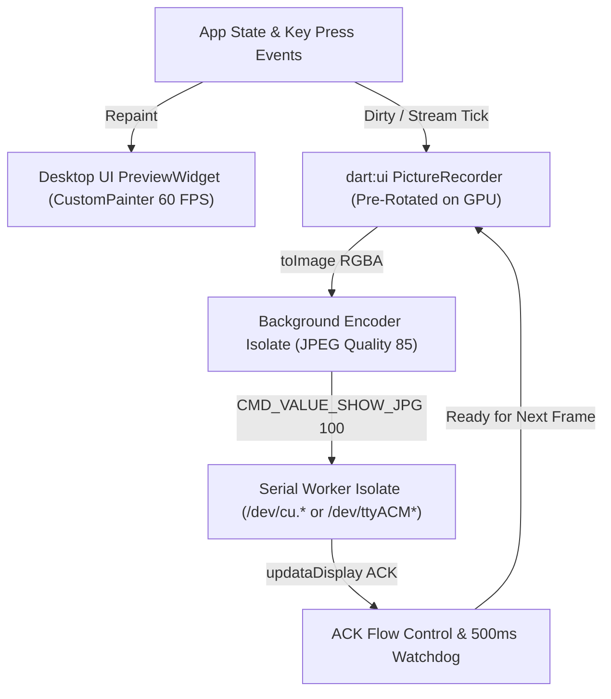

# Lessons Learned Building `pocflutter` & Production Flutter App Guide

This document captures the technical findings, platform-specific bugs uncovered during live hardware bring-up, architectural trade-offs, and concrete engineering recommendations learned while building and debugging the Waveshare SK18 Flutter Proof-of-Concept (`pocflutter/`). Use this guide as the reference blueprint when designing and building the production Flutter application.

---

## 1. Executive Summary

Replicating the C++/Qt proof-of-concept (`poc/`) in Flutter (`pocflutter/`) confirmed that a pure Dart/Flutter desktop application can drive the Waveshare SK18 at 25 FPS, handle asynchronous physical key events, and manage on-device WAV files without complex C++ build toolchains. However, testing against physical SK18 hardware (`/dev/cu.usbmodem*` on macOS, Allwinner T113-S3 running `/data/KeyboardDevice` `V2.32`) exposed several critical platform, protocol, and rendering subtleties that are not obvious from documentation alone:

1. **Dart `dart:io` Character Device Pitfalls**: Opening USB CDC-ACM serial nodes with standard `FileMode.append` or `File.openRead()` fails on POSIX character devices due to `lseek(SEEK_END)` (`ESPIPE`, `errno = 29`), macOS driver `termios` resets on descriptor close, and uninterruptible background read threads in the Dart VM.
2. **Firmware Coordinate & Orientation Quirks**: Stock firmware `V2.32` reports unflipped key coordinates in `getInfo` (requiring a `+12 px` margin correction) and always reports physical button presses in native portrait coordinates (`3 cols × 6 rows`), even when the host streams rotated landscape frames (`6 cols × 3 rows`).
3. **Frame Encoding & Streaming Bottlenecks**: Rasterizing `dart:ui` canvases, rotating `1280×720` RGBA buffers 90° on the CPU, and JPEG-encoding in pure Dart takes ~15–35 ms per frame on the UI isolate, requiring strict ACK flow control, re-entrancy guards, and GPU pre-rotation / background Isolate offloading for production.

---

## 2. USB CDC-ACM Serial Transport in Dart (`dart:io`)

The most critical bugs discovered during hardware bring-up occurred in the POSIX serial layer (`lib/services/sk18_client.dart`). Notably, the earlier naive pattern (`stty` followed by `File.open(mode: FileMode.append)` and `File.openRead()`) fails completely against real hardware on macOS.

### 2.1 Pitfall 1: `FileMode.append` Fails with `ESPIPE` (`errno = 29`) on Character Devices
- **What Happened**: Calling `await file.open(mode: FileMode.append)` on `/dev/cu.usbmodem1101` threw:
  ```text
  FileSystemException: Cannot open file, path = '/dev/cu.usbmodem1101' (OS Error: Illegal seek, errno = 29)
  ```
- **Root Cause**: Inside the Dart VM's `dart:io` C++ implementation (`_File.open`), opening a file in `FileMode.append` or `FileMode.writeOnlyAppend` executes an explicit `lseek(fd, 0, SEEK_END)` check after `open(2)`. Because `/dev/cu.usbmodem*` and `/dev/ttyACM*` are non-seekable character devices (`S_IFCHR`), the kernel returns `ESPIPE` (`errno = 29`), and Dart immediately closes the descriptor and throws.
- **Production Rule**: Always open serial device nodes with **`FileMode.write`** (which maps to `O_RDWR | O_CREAT | O_TRUNC` in Dart without calling `lseek`).

### 2.2 Pitfall 2: Running `stty` Before Opening the Port Resets `termios` on macOS
- **What Happened**: Running `Process.run('stty', ['-f', devicePath, '115200', 'raw', '-echo', ...])` *before* opening the port in Dart left the port in its default `9600` baud canonical mode.
- **Root Cause**: On macOS (`AppleUSBCDCACMData` kernel driver), `termios` settings are only retained while at least one file descriptor remains open on the device node. As soon as the short-lived `stty` subprocess exited and closed its file descriptor, the kernel driver reset `/dev/cu.usbmodem*` back to default `9600` baud, canonical line-buffered mode, and blocking `VMIN=1`.
- **Production Rule**: Open the device descriptor in your process **first**, hold that handle open, and **then** apply `termios` settings (`stty` or `tcsetattr`) while the descriptor is held open.

### 2.3 Pitfall 3: `File.openRead()` Races Handshake Writes & Leaks Blocked VM Worker Threads
- **What Happened**: Using `file.openRead().listen(...)` alongside a `RandomAccessFile` writer caused two severe failure modes:
  1. `file.openRead()` opens a **second** file descriptor asynchronously on a Dart VM I/O worker thread. Sending the V1 abort sequence and `getInfo` request immediately after `openRead().listen(...)` raced with that asynchronous open.
  2. When a user disconnected or reconnected, calling `await _readSub?.cancel()` did **not** terminate the in-flight blocking `read(fd, 65536)` system call on the Dart VM worker thread. That zombie thread remained blocked in the kernel across reconnects and stole the first chunk of incoming bytes (`AA551234 Abort file transfer ok` and the `A1 A5 5A 5E` header of `getInfo`) from the next session, causing `getInfo` to hang or fail CRC validation.
- **Production Rule**:
  - Never use `File.openRead()` on serial character devices.
  - Configure the port for non-blocking reads (`min 0 time 0`, i.e. `VMIN=0, VTIME=0`):
    ```bash
    # macOS:
    stty -f /dev/cu.usbmodem1101 115200 raw -echo clocal cread cs8 -cstopb -parenb min 0 time 0
    # Linux:
    stty -F /dev/ttyACM0 115200 raw -echo clocal cread cs8 -cstopb -parenb min 0 time 0
    ```
  - Drain any stale unread bytes buffered by the OS kernel driver immediately after opening (`while (raf.readSync(4096).isNotEmpty) {}`).
  - Use the **single** `RandomAccessFile` descriptor for both writes (`writeFromSync`) and non-blocking reads (`readSync(65536)`). Because `VMIN=0, VTIME=0` causes `read(2)` to return `0` (`Uint8List(0)`) immediately when no bytes are available, polling `readSync` on a timer never blocks a VM thread and stops cleanly on disconnect.

### 2.4 Pitfall 4: macOS `/dev/tty.*` vs `/dev/cu.*` and USB VID:PID Discovery
- **Dial-in vs Call-out Nodes**: On macOS, `/dev/tty.usbmodem*` is a dial-in device that blocks inside `open(2)` waiting for hardware Data Carrier Detect (DCD). Always normalize `/dev/tty.*` to `/dev/cu.*` (call-out device) before opening.
- **Fast VID:PID Filtering**:
  - The SK18 Allwinner T113-S3 Linux USB composite gadget enumerates with `VID:PID = 1d6b:0104` (or `1234:5678` in alternate modes).
  - On macOS, `ioreg -p IOUSB -l -w 0` executes in `< 15 ms` (much faster than `system_profiler SPUSBDataType`), but outputs `idVendor` and `idProduct` in **decimal** (`7531` for `0x1d6b`, `260` for `0x0104`, `4660` for `0x1234`, `22136` for `0x5678`). Port discovery logic must match both hex (`0x1d6b`) and decimal (`7531`) strings.
  - On Linux, walking `/sys/class/tty/ttyACM*/device` (`..`, `../..`) to read the `idVendor` and `idProduct` sysfs files is instantaneous and requires no external tools.

### 2.5 Pitfall 5: macOS App Sandbox Entitlements
- Flutter's default `macos/Runner/DebugProfile.entitlements` and `Release.entitlements` enable `com.apple.security.app-sandbox = true`, which blocks opening `/dev/cu.usbmodem*` and spawning `/bin/stty`.
- For direct-download macOS builds, set `com.apple.security.app-sandbox` to `false`. If targeting the Mac App Store, enable `com.apple.security.device.serial` and configure `termios` directly via Dart FFI (`libc`) rather than spawning `/bin/stty`.

### 2.6 Production Architecture Recommendation for Serial I/O
While `pocflutter`'s single-`RandomAccessFile` + `stty ... min 0 time 0` + 5 ms `Timer.periodic` polling works reliably with zero native dependencies, the production app should move serial I/O into a dedicated **Serial Worker `Isolate`** using **Dart FFI (`dart:ffi`) bound to POSIX `libc`**:
- Call `open(path, O_RDWR | O_NOCTTY | O_NONBLOCK)` directly.
- Configure `struct termios` via `tcgetattr` / `cfmakeraw` / `cfsetspeed(B115200)` / `tcsetattr(TCSANOW)` and flush kernel queues via `tcflush(fd, TCIOFLUSH)` without spawning an external `stty` process.
- Assert DTR/RTS via `ioctl(fd, TIOCMBIS, &bits)` so CDC-ACM line state notifications work consistently across all host OS kernels.

---

## 3. Protocol V1/V2 Handshake, Framing & Firmware Quirks

### 3.1 Fast V1 Abort vs Legacy 1 MB `'0'` Flood
- On cold boot or after an interrupted transfer, `/data/KeyboardDevice` `V2.32` listens in Protocol V1 mode (`FIXEDCMDHEAD` = `AA551234`).
- The vendor demo's legacy flush sends `1,048,576` `'0'` (`0x30`) bytes, taking ~90 ms and filling serial buffers.
- Sending the 37-byte V1 abort command `AA551234 Abort file transfer 123455AA` immediately transitions the firmware to Protocol V2 in `< 1 ms`.
- **Parser Requirement**: The firmware responds with raw ASCII `AA551234 Abort file transfer ok` before emitting binary Protocol V2 frames (`0xA1A55A5E`). The V2 stream parser must scan forward for the 4-byte V2 magic header (`_findNextHeaderOffset`), detect the ASCII abort ACK in any discarded prefix bytes, and never treat that prefix as a framing error.

### 3.2 Dual Magic Header Endianness & Two-Stage CRC Resynchronization
- **Magic Header**: Stock firmware `V2.32` transmits magic bytes `A1 A5 5A 5E` (`0xA1, 0xA5, 0x5A, 0x5E`) while all remaining 32-bit fields in the 24-byte header (`size_crc`, `size`, `id`, `cmd`, `pkt_crc`) are **little-endian**. Custom firmware also supports little-endian magic `5E 5A A5 A1`.
  - **Rule**: Always transmit `A1 A5 5A 5E` for stock firmware compatibility, and accept **both** `A1 A5 5A 5E` and `5E 5A A5 A1` in the receiver.
- **Two-Stage CRC Resynchronization**:
  - Always verify `size_crc == calcDataCrc32(header[8..11])` and `0 < size <= 16 MB` *before* waiting for `size` payload bytes. If `size_crc` fails, drop only the 4-byte false magic header (`removeRange(0, 4)`) and rescan immediately; otherwise a single corrupted header would stall the receiver waiting for gigabytes of data.
  - If `pkt_crc` fails after `size` bytes have arrived, drop only the 24-byte header (`removeRange(0, 24)`) rather than discarding the payload buffer, as a valid V2 packet header may reside inside those bytes.

### 3.3 Stock Firmware `V2.32` Unflipped Margin Bug (`+12 px` Auto-Correction)
- Physically, the SK18 bezel has an asymmetric `10 px` margin on one edge and a `22 px` margin on the opposite edge (`10 + 6*158 + 5*60 + 22 = 1280 px`). Because the LCD panel is mounted rotated inside the chassis, the top physical margin in portrait (`720×1280`) is `22 px` and the bottom is `10 px` (or `22 px` left and `10 px` right in landscape `1280×720`).
- However, stock firmware `/data/KeyboardDevice` `V2.32` returns unflipped key coordinates in `getInfo`:
  - Portrait (`720×1280`): `rects.first.y == 10` instead of `22`.
  - Landscape (`1280×720`): `rects.first.x == 10` instead of `22`.
- Rendering at the raw `getInfo` coordinates shifts all 18 key tiles by `12 px` relative to the physical keycap cutouts.
- **Production Rule**: Automatically apply `+12 px` to all key `y` coordinates when `isPortrait && rects.first.y == 10` (producing `y = 22, 240, 458, 676, 894, 1112`) and `+12 px` to all key `x` coordinates when `!isPortrait && rects.first.x == 10` (producing `x = 22, 240, 458, 676, 894, 1112`). Also retain a per-device user calibration offset (`offsetX`, `offsetY` in `-64..+64 px`) persisted in app preferences to compensate for mechanical assembly tolerance.

### 3.4 Portrait-to-Landscape Key Event Remapping (`fromPhysicalDevice` Distinction)
- The SK18 LCD scanout is natively `720×1280` (portrait, `3 cols × 6 rows`), whereas most users use the keypad in `1280×720` landscape orientation (`6 cols × 3 rows`).
- When authoring in `1280×720` landscape and rotating outgoing JPEG frames 90° clockwise for the portrait hardware display, the SK18 firmware **still** emits `keyStateChanged` JSON-RPC notifications using native portrait coordinates (`physCol in 0..2`, `physRow in 0..5`).
- **Production Rule**:
  - Remap incoming physical hardware events `(physCol, physRow)` to logical landscape `(col, row)` via:
    ```dart
    final int logicalCol = physRow; // 0..5
    final int logicalRow = (deviceInfo.rectCols - 1) - physCol; // 2 - physCol (0..2)
    ```
  - **Crucial Distinction**: Simulated clicks coming from the desktop UI's already-landscape preview widget must **not** pass through this physical-to-logical remapping (`fromPhysicalDevice: false`). Mixing the two causes simulated clicks in columns `3..5` to wrap into negative row indices.

---

## 4. Canvas Rendering, 90° Rotation & Hardware JPEG Streaming



### 4.1 Dual-Path Rendering (`CustomPainter` vs Offscreen Rasterizer)
- Sharing a single `paintLogicalCanvas(Canvas canvas, Size size)` routine between Flutter's `CustomPainter` (for the desktop preview window) and `ui.PictureRecorder` (for offscreen hardware frame generation) worked extremely well:
  - The desktop preview stays crisp and responsive at 60/120 FPS with zero JPEG encoding overhead.
  - Offscreen rasterization only runs when transmitting a frame to the device or exporting to disk.

### 4.2 Eliminating CPU 90° Rotation Overhead via GPU Canvas Pre-Rotation
- In `pocflutter`, `Sk18CanvasRenderer.renderFrameImage()` rasterized a `1280×720` `ui.Image`, extracted `3.68 MB` of RGBA bytes, constructed a `package:image` buffer, and called `img.copyRotate(image, angle: 90)` on the CPU before `img.encodeJpg()`.
- **Production Optimization**: Instead of rotating `921,600` pixels on the CPU in Dart, rotate the `dart:ui` `Canvas` on the GPU *before* drawing when `rotateForPortraitDevice && deviceInfo.isPortrait`:
  ```dart
  final recorder = ui.PictureRecorder();
  final canvas = Canvas(recorder, const Rect.fromLTWH(0, 0, 720, 1280));
  canvas.translate(720, 0);
  canvas.rotate(math.pi / 2); // 90° clockwise on GPU
  paintLogicalCanvas(canvas, const Size(1280, 720));
  final ui.Image rotatedImage = await recorder.endRecording().toImage(720, 1280);
  ```
  This produces an already-rotated `720×1280` RGBA buffer directly from Flutter's Impeller/Skia GPU rasterizer at zero CPU cost.

### 4.3 Offloading JPEG Encoding from the Main UI Isolate
- Pure-Dart `img.encodeJpg(image, quality: 85)` on a `1280×720` frame takes `15–30 ms` of synchronous CPU work. Running this on the main UI isolate at 25 FPS (`40 ms` budget) consumes up to 75% of the UI thread's frame budget.
- **Production Rule**:
  1. Send the raw `Uint8List` RGBA buffer (`TransferableTypedData`) to a persistent background **Encoder `Isolate`** (or use FFI to `libjpeg-turbo` / macOS `ImageIO` / Linux `libjpeg` for `< 2 ms` SIMD JPEG encoding).
  2. Enforce **event-driven / dirty-flag streaming**: only rasterize and transmit a new JPEG frame when visual state has changed (e.g., key press/release animation, clock minute/second change, live sensor telemetry update, or page switch), rather than continuously re-encoding identical static frames at 25 FPS.

### 4.4 Hardware CedarX Constraints & ACK Flow Control
- **16-Pixel MCU Alignment**: The Allwinner T113-S3 uses hardware CedarX (`jpegdecode` + `/dev/g2d`) to decode `CMD_VALUE_SHOW_JPG = 100` frames. Both `1280×720` and `720×1280` are exact multiples of 16 (`1280 = 80×16`, `720 = 45×16`); never send arbitrary cropped dimensions or progressive JPEGs.
- **ACK Gating + 500 ms Watchdog**:
  - Every `CMD_VALUE_SHOW_JPG` packet is acknowledged by the firmware with `{"ack_method":"updataDisplay","result":"ok"}`.
  - Keep the dual guard (`_isEncodingFrame` + `_waitingForFrameAck`) so the host never queues multiple uncompressed `3.68 MB` frames in memory or overflows the USB CDC-ACM buffer, paired with a `500 ms` watchdog timer that clears `_waitingForFrameAck` if an ACK is lost.

---

## 5. Chunked WAV Upload & RPC Multiplexing

- **64 KB Chunked Upload State Machine**:
  - Uploading audio files via `saveToFile` requires splitting the local `.wav` file into `65,536`-byte chunks, Base64-encoding each chunk, advancing sequentially only after receiving `{"ack_method":"saveToFile","result":"ok"}` for the current chunk, and finishing with `setFileCRC` (carrying the lowercase 8-hex-digit IEEE 802.3 CRC32 of the entire file).
- **Bandwidth Contention During Upload**:
  - Base64-encoded 64 KB chunks (~87 KB JSON packets) share the same serial pipe as `CMD_VALUE_SHOW_JPG` frames (~45–70 KB each).
  - **Production Rule**: Automatically pause or throttle background JPEG frame streaming while a `saveToFile` upload is in progress, and resume display streaming once `setFileCRC` completes.
- **Request/Response Correlation**:
  - In `pocflutter`, `Sk18Client` dispatches responses via broadcast streams (`onDeviceInfoReceived`, `onFileListReceived`, `onFrameAckReceived`). For a production app with concurrent RPC requests, correlate every outbound `CMD_VALUE_JSON = 101` packet `id` with a `Map<int, Completer<Map<String, dynamic>>>` (with per-request timeouts) while routing unsolicited `method` packets (`keyStateChanged`) to an event bus.

---

## 6. Flutter Desktop UI & Automated Testing Lessons

1. **Test Font (`Ahem`) Layout Overflows in `flutter test`**:
   - Flutter's widget test environment uses the `Ahem` font, where every character is a wide square block. Fixed-width controls or `Row` children without `Expanded` / `Flexible` will throw `RenderFlex overflowed` errors in `flutter test` even when they fit comfortably on macOS/Linux with system fonts.
   - Always wrap side-by-side inputs/buttons in `Expanded` or `Flexible`, and set a desktop viewport size (`tester.view.physicalSize = const Size(1440, 960); tester.view.devicePixelRatio = 1.0;`) at the start of widget tests.
2. **`FakeAsync` Deadlocks with `Picture.toImage()` and `dart:io`**:
   - Inside `testWidgets`, calling `Sk18CanvasRenderer.renderJpeg()` or performing real temporary file I/O will hang unless wrapped in `await tester.runAsync(() async { ... })`, because `Picture.toImage()` requires real asynchronous engine rasterization outside `FakeAsync`.
3. **Timer Cleanup on Controller Disposal**:
   - Any periodic timer (the 1 Hz status-bar clock timer, the 25 FPS stream timer, the 500 ms ACK watchdog, and the 5 ms serial read poll timer) **must** be canceled inside `dispose()` / `disconnectDevice()`. Leaving a timer active causes `flutter test` to fail teardown with `A Timer is still pending even after the widget tree was disposed`.
4. **Built-in `--self-test` and `--probe` Modes**:
   - Shipping `--self-test` (verifying CRC32 vectors, geometry presets, `+12 px` firmware margin correction, fragmented packet reassembly, corrupted `size_crc` resync, and offscreen JPEG dimensions) and `--probe` (CLI hardware handshake + test frame) directly in the binary proved invaluable for diagnosing hardware vs UI issues in isolation. Retain a diagnostics/self-test suite in the production app.

---

## 7. Production App Readiness Checklist

| Area | `pocflutter` Implementation | Production App Target |
| :--- | :--- | :--- |
| **Serial I/O** | `RandomAccessFile(FileMode.write)` + `stty ... min 0 time 0` + 5 ms `readSync` timer on UI isolate | Dedicated **Serial Worker `Isolate`** with POSIX `libc` FFI (`open`, `tcsetattr`, `tcflush`, `ioctl`) + auto-reconnect on USB hotplug |
| **Frame Rotation** | CPU `package:image` `copyRotate(angle: 90)` on `1280×720` RGBA buffer | **GPU Canvas pre-rotation** (`canvas.translate(720, 0); canvas.rotate(pi / 2)`) prior to `Picture.toImage(720, 1280)` |
| **JPEG Encoding** | Pure Dart `package:image` `encodeJpg` on main isolate (`~15–30 ms`) | Background **Encoder `Isolate`** (or native `libjpeg-turbo` / `ImageIO` FFI `< 2 ms`) |
| **Frame Cadence** | Continuous 25 FPS timer (`40 ms`) when streaming is toggled on | **Dirty-region / event-driven** frame push (render on state change, key press animation, or clock tick) + ACK backpressure |
| **Key Coordinates** | Automatic `+12 px` firmware margin fix + global `(dx, dy)` offset | Persist per-device `(offsetX, offsetY)` and orientation preset in local config; keep `fromPhysicalDevice` coordinate remapping |
| **File Upload** | 64 KB chunked `saveToFile` + `setFileCRC` state machine | Pause display streaming during active uploads; add retry-on-chunk-timeout and CRC cache check via `getFilesBySuffix` before re-uploading existing WAVs |
